## Hi there 👋

- 🕺 24 years old
- 🏠 Live in Chiba, Japan🇯🇵
- 🌱 Obsessed with Flutter📚
- 🤩 Favorites: ☕︎✈️🪐⚾

### Skills

  <picture>
    <source media="(prefers-color-scheme: dark)" srcset="https://skillicons.dev/icons?i=py%2Copencv%2Cflutter%2Cdart%2Cfirebase%2Cts%2Creact%2Cnextjs%2Ctailwind%2Cvercel%2Cgit%2Cgithub&amp;theme=dark&amp;perline=6" />
    <source media="(prefers-color-scheme: light)" srcset="https://skillicons.dev/icons?i=py%2Copencv%2Cflutter%2Cdart%2Cfirebase%2Cts%2Creact%2Cnextjs%2Ctailwind%2Cvercel%2Cgit%2Cgithub&amp;theme=light&amp;perline=6" />
    
  </picture>

### GitHub stats

  <picture>
    <source media="(prefers-color-scheme: dark)" srcset="https://raw.githubusercontent.com/hiro-sd/hiro-sd/refs/heads/main/assets/github-stats-dark.svg" />
    <source media="(prefers-color-scheme: light)" srcset="https://raw.githubusercontent.com/hiro-sd/hiro-sd/refs/heads/main/assets/github-stats-light.svg" />
    
  </picture>
  <picture>
    <source media="(prefers-color-scheme: dark)" srcset="https://raw.githubusercontent.com/hiro-sd/hiro-sd/refs/heads/main/assets/top-languages-dark.svg" />
    <source media="(prefers-color-scheme: light)" srcset="https://raw.githubusercontent.com/hiro-sd/hiro-sd/refs/heads/main/assets/top-languages-light.svg" />
    
  </picture>

### Contribution activity

<picture>
  <source media="(prefers-color-scheme: dark)" srcset="https://raw.githubusercontent.com/hiro-sd/hiro-sd/refs/heads/main/assets/github-contribution-grid-snake-dark.svg" />
  <source media="(prefers-color-scheme: light)" srcset="https://raw.githubusercontent.com/hiro-sd/hiro-sd/refs/heads/main/assets/github-contribution-grid-snake.svg" />
  
</picture>
